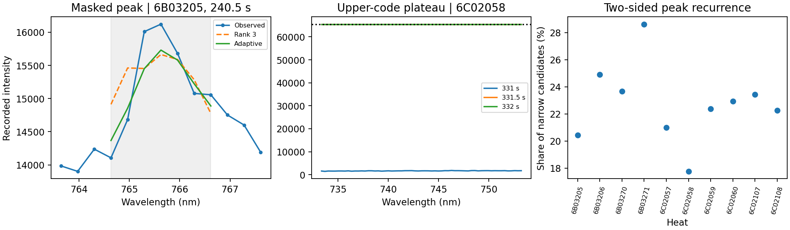

# 第一问优化：窄峰保护与十炉光谱诊断

> **2026-11-26 数据版本更新。** 本专题的光谱原值在更正版中逐点一致，此处的峰保护试验仍有效。全域情景、新的同标定族试验与当前采用的模型见新版。 当前请参阅[第三版数学模型](2026%20APMCM%20B%E9%A2%98%E2%80%94%E2%80%94%E7%AC%AC%E4%B8%89%E7%89%88%E6%95%B0%E5%AD%A6%E6%A8%A1%E5%9E%8B%E4%B8%8E%E5%AE%9E%E9%AA%8C%E8%AF%81%E6%8D%AE.md)与[实验进度](%E5%AE%9E%E9%AA%8C%E8%BF%9B%E5%BA%A6.md)。

**修订结论。** 单帧峰形用于找候选，相邻帧与峰肩用于判断成因。持续窄峰优先保留实测值；需要修复时，以本炉谱形为基准，与跨炉共享谱形、按当前亮度校正的邻帧模板比较。65,535 平台单独标记，允许输出“真峰与伪影无法判定”。四项决策解决不同的观测问题。

## 一　原始光谱显示五个问题有多严重

逐一读取十个 XLSB，复核 SHA-256。诊断覆盖 **13,589 帧、27,816,683 个光强读数**。沿各炉原生 nm 网格找峰。峰数是“帧内峰中心出现次数”，持续多帧的谱线会重复计数。附件缺少已标注异常、仪器线形、曝光日志及未截顶的平行观测。

| 全量检查 | 实际结果 | 决策 |
|---|---|---|
| 显著且半显著性宽度 ≤1.5 nm 的未封顶正峰，排除首末帧 | 81,619 次 | 窄峰很常见。仅按宽度删除会改动大批数据 |
| 前后各 0.5 s 在 ±1 原生通道内均有同类峰 | 18,190 次，占 22.3% | 有时间持续证据，优先保护；不能据此给出物种归属，也不能排除固定通道伪影 |
| 两侧邻帧均未见同类正峰 | 45,928 次；加入峰肩校正及残差门槛后仅 **582 个**正向中心标为可疑 | “只出现一次”远不足以确认伪影 |
| 负向窄谷的镜像筛查 | 91,101 个候选，592 个标为可疑 | 吸收样结构也可能有连续窄谷。负向清单单列，正尖峰注入结果不外推到负尖峰 |
| 读数等于 65,535 | 8 炉、92 帧、14,805 点；其中 14,713 点同帧紧邻另一个上限点。最大时间—波长四连通区域为 1,593 点，位于 6C02057 | **99.38%** 有横向平台证据，与孤立尖峰具有不同几何形态。实际截顶机制仍需设备说明 |
| 相邻两帧全谱均值相差超过两倍（包括上升、下降） | 各炉比例约 7.1%–33.8%，最高为 6C02058 | 同一峰可持续，但整帧亮度已大变。直接取前后帧均值补峰会失真，成因无法仅凭光谱确认 |

582 个正向与 592 个负向可疑中心合计为全部读数的 0.00422%。这是保守规则的标记比例，不能当成真实异常率。[逐炉完整统计](../../results/q1/tables/q1_peak_audit.csv)

左图灰区为遮住的七个中心通道。中图中，连续三帧有两帧在所示波段贴住上限，另一帧明显较暗。相邻帧信息有价值，也需要先检验亮度是否匹配。

## 二　哪些峰能判，哪些只能保留两个解释

供讨论的观测式为 $Y=L+P+S+\varepsilon$。若真实窄峰允许仅持续一帧，其宽度又接近一个通道，矩阵 $e_i e_j^\top$ 同时满足秩一、稀疏、局部三种性质。把它从 $P$ 挪到 $S$ 完全不改变观测。允许任意峰形背景时，$L$ 与 $P$ 也不唯一。因此操作上先冻结正常谱形估计，再用独立的邻域证据校正，只在支持的局部估峰。区分所需的信息来自前后帧、当前波长邻域、峰宽和跨帧强度变化；缺乏这些信息时应输出待判。[低秩与稀疏分离的理论条件](https://doi.org/10.1145/1970392.1970395)

**本轮实算的判据。** 每帧在 31 通道窗口内算局部显著性 $p$ 和半显著性宽度 $W$。正向候选要求 $p\ge\max(250,0.065Y_{ij})$、$W\le1.5$ nm，宽度由左右插值交点换算成 nm；负向候选在反号光谱上算突出度。阈值为操作设定，不能据此推断仪器分辨率。前后帧均找不到 ±1 通道匹配时，令 $M_k=(Y_{i-1,k}+Y_{i+1,k})/2$，用 $J=j+\{-4,-3,3,4\}$ 作为峰肩，计算
$$
g=\operatorname{median}_{k\in J}\frac{Y_{ik}}{\max(1,M_k)},\quad
r_j=Y_{ij}-gM_j,\quad
s=\max\{1,1.4826\operatorname{median}_{k\in J}|Y_{ik}-gM_k|\}.
$$
正向须有 $r_j>\max(6s,0.08Y_{ij})$ 才进入可疑清单；负向用 $-r_j$。接近边缘、峰肩也污染、双轴证据冲突或可解释为真实瞬态时，保留原值并标为待判。持续峰上叠加一次异常可能被保护规则漏掉，可另外比较峰顶与其余峰形的残差；这类点不自动删除。CWT 可作为多尺度复核工具，同一原始观测的小波系数不能替代独立证据。双边邻帧仅用于第一问离线重构；用于实时预测时必须改单边，或明确计入一帧确认时间。

### 受控尖峰注入

从各炉抽三帧、41 通道片段，排除最大值超过 50,000 的片段。在中间帧的中心位置注入 $a\max(2500,Y_{ij})$，同一原始位置另留未注入对照。固定种子，每炉每档尝试 160 次，按可用片段计数；Precision、Recall 均针对已知注入标签。

| 注入档位 | 有注入 / 未注入 | 单帧峰形 Precision / Recall | 时间—波长联合 Precision / Recall | 未注入位置被标记：单帧 / 联合 |
|---|---:|---:|---:|---:|
| $a=0.12$ | 1,575 / 1,575 | 99.55% / 98.86% | 100% / 82.22% | 7 / 0 |
| $a=0.40$ | 1,561 / 1,561 | 99.81% / 99.81% | 100% / 97.89% | 3 / 0 |

联合规则保护更多原始读数，也漏掉了部分弱尖峰。这里阳性比例人为设为 50%，只考察未封顶的单帧单通道正干扰。100% 不能作为自然异常的识别精度。实际数据没有异常真值，持续峰复现率也不能充当自然 Precision/Recall。[注入明细](../../results/q1/tables/q1_peak_injection.csv)

## 三　遮住真实峰，比较低秩、局部模板与自适应平滑

每 17 帧取一帧，用两侧相邻帧的谱形选择峰中心，每帧至多三个。在 13 通道片段里遮住中间七个，只提供两侧六个峰肩和其余可见数据。排除触及 65,535 的片段；评分限于揭示后确有净峰高超过 250 的可辨认峰。共 **1,166 个**。三个峰指标均在同一七点窗口中相对于两侧内峰肩的连线计算：峰高取最大正超额，峰位取其波长，峰面积按实际 nm 作正超额梯形积分。各炉等权，RMSE 为各炉 MSE 等权平均再开根。

| 峰中心恢复方法 | MAE | RMSE | 峰高相对误差 | 峰面积相对误差 | 峰位误差 nm |
|---|---:|---:|---:|---:|---:|
| 同帧峰肩 PCHIP | 619.1 | 1,161.6 | 97.0% | 95.8% | 0.631 |
| 前后帧直接平均 | 2,727.6 | 5,044.5 | 198.6% | 385.3% | 0.264 |
| 前后帧模板，按当前峰肩校正亮度 | 238.1 | 490.8 | 25.7% | 29.0% | 0.059 |
| 校正模板＋均匀曲率惩罚 | 343.7 | 600.0 | 51.4% | 30.5% | 0.084 |
| 校正模板＋自适应曲率惩罚 | 269.9 | 504.0 | 37.8% | 29.0% | 0.056 |
| 其余九炉共享基，秩 3 | 403.1 | 738.9 | 54.7% | 73.3% | 0.104 |
| 其余九炉共享基，秩 12 | 158.7 | 254.1 | 24.6% | 23.7% | 0.056 |
| 仅另一种波长标定的炉训练，秩 12 | 361.9 | 636.6 | 53.1% | 65.9% | 0.086 |
| 本炉其他时刻训练，秩 12 | 145.1 | 240.4 | 20.7% | 18.3% | 0.056 |
| 本炉秩 12＋局部模板，模板权重 0.25 | 143.9 | 240.4 | 18.9% | 18.1% | 0.052 |

低秩对照在 345–1015 nm 的 1,200 点共同网格上每 10 s 抽一帧，按炉中心化、按帧数平方根缩放，再做低秩拟合。将基映射回原生通道，用该帧可见通道求得分。各低秩方法用同一份本炉静态均值；均值及本炉基均排除目标帧和前后各一帧。“共享”指方向来自其余炉；本炉其他时刻可用于离线静态校正。仅按峰肩缩放本炉均值的 MAE 为 284.1。跨标定性能下降还混有炉群差异，不能单独归因于仪器。宽带诊断显示的三维结构在这里损失了窄峰面积；本炉基在 6/10 炉优于九炉共享基。

均匀与自适应对照使用同一局部目标。除峰肩观测残差平方和外，加 $0.8\sum_k(f_k-T_k)^2+4\sum_k v_k(\Delta^2 f_k)^2$，$T$ 为峰肩校正模板。均匀取 $v_k=1$；自适应对有邻帧支持的峰中心 ±3 通道取 0.12，其余取 1。自适应减少均匀惩罚所致的削峰，但其峰高误差仍大于直接模板。这里比较的是局部曲率模型；较宽波段的二维样条应改用实际 nm 导数并分别选择两轴惩罚。[逐事件结果](../../results/q1/tables/q1_peak_mask_tests.csv)

**避免从整张表挑最优权重。** 每炉前半程的遮挡事件选择本炉/共享基和模板权重，后半程留出 **474 个事件**。逐炉选择的 MAE 为 **155.2**，峰高与峰面积误差为 **20.6%、19.0%**；固定共享基分别为 163.9、25.5%、22.8%，固定本炉基为 164.1、22.1%、21.1%。逐炉选择的 RMSE 为 263.7，略高于固定共享基的 255.5。按炉对配对 MAE 差重抽 20,000 次，逐炉选择相对固定共享基为 −8.7，探索性 95% 百分位区间 [−32.4, 10.2]；相对固定本炉基为 −8.9，区间 [−26.0, 3.5]。这是离线重构，训练基可利用本炉未遮挡的其他时刻。**应保留本炉与共享候选；0.25 和秩 12 都不能写成最优常数。** [时间分段验证](../../results/q1/tables/q1_peak_blocked.csv)

## 四　65,535 的证据与可恢复范围

主表保留观测值、上限掩码及平台面积。普通观测与右删失两种情景并列。若仪器确认硬上限 $C$，且截顶前带噪读数 $Z=F+\epsilon,\ \epsilon\sim N(0,\sigma^2)$，则 $Y=\min(Z,C)$，顶格点的负对数似然为 $-\log[1-\Phi((C-F)/\sigma)]$。已知下界约束的是 **$Z\ge C$**，不能严格推出无噪平均强度 $F\ge C$。删失损失随 $F$ 增大可趋于零；没有未截顶峰翼、邻帧或有效上界先验时，数据本身不给有限峰顶。此时曲面仍可画至观测下界，必须叠加平台掩码。

在未封顶峰中人为施加“平均基线＋70% 局部峰高”的阈值，只对实际被截掉的中心通道计算误差。直接保留截顶值的炉等权 MAE 为 **312.0**；使用峰肩校正模板，并将所估的截顶前读数限制在人工阈值以上，MAE 为 **281.2**，仅 **5/10 炉**改善。这个简单下界模板不是高斯删失似然估计；真实平台可跨多帧，人工试验有可用邻帧，不能把 281.2 解释为真实上限点的恢复误差。[人工截顶结果](../../results/q1/tables/q1_peak_pseudoclip.csv)

## 五　第一问最终采用的模型结构

1. **在观测充分处以原生读数为锚。** 给每个点保存正常、可疑、待判、疑似截顶标记。正常持续峰优先保留；对可疑点另存建议修复值与差值。用观察到的同帧宽带变化剔除整体亮度突变解释。峰肩或邻帧同样被污染时，降低修复置信度。
2. **在缺测或可疑峰上，只估有约束的局部校正。** 基础谱形取 $L_{hi}(\lambda)=m_h(\lambda)+\sum_{k=1}^r a_{hik}\phi_k(\lambda)$。$m_h$ 为本炉静态谱形，$\phi_k$ 候选来自本炉或其余炉，$a_{hik}$ 由当前可见波段求得。跨炉共享限于共同波长域，域外使用本炉局部插值。对有邻帧证据的峰取 $T=gM$，用 $P=\omega(T-L)$、$\widehat F=L+P$ 修正；$\omega$ 在 0、0.25、0.5、0.75、1 中按炉验证。无峰支持时不强行估 $P$。此处 $L$ 可包含反复出现的正常谱线，$P$ 是带符号的局部校正。它们不能解释为唯一的物理背景与纯发射线强度。对宽带也难以低秩表示的片段，基准为本炉二维样条；局部验证误差优先于解释方差。
3. **从修复节点获得连续曲面。** 保守交付是在本炉原生时间—波长矩形网格上对节点使用双线性张量积 B 样条（两轴各一次），通过可信峰值且避免过冲。在平坦高噪声区可比较带约束的平滑曲面：最小化可见节点残差加 $\lambda_t\iint v_t|\partial_{tt}F|^2+\lambda_\lambda\iint v_\lambda|\partial_{\lambda\lambda}F|^2$。保护峰的观测点作锚；局部证据支持转折时降低相应轴的惩罚。遮挡先于筛查，再用时间块、波段块的误差和峰高/面积共同选参数。若只有背景 RMSE 改善而可信峰被削弱，保留低阶插值。全域自适应样条和正式十炉曲面尚需独立验证，当前证据来自局部曲率对照与实际峰遮挡。
4. **有证据才增加跨炉约束。** 本炉和共享基在时间分段测试中胜负不一。独立炉次的第 $i$ 行不对应相同反应，不能直接作为 JIVE 的共同对象。PARAFAC2 可容许不同炉次长度，但仍要求可比较的公共模态及跨炉因子内积约束。待这些假设可检验时再上张量模型。仅在训练炉上冻结的共同基可交给第三问，离线本炉均值和未来邻帧不能用于实时预测。[JIVE](https://doi.org/10.1214/12-AOAS597) · [Probabilistic PARAFAC2](https://doi.org/10.3390/e26080697)

## 六　文献核查与复现

- Coca-Lopez 的峰宽和显著性支持灵敏初筛；Li 与 Dai 给出局部移动窗口与局部拟合的先例。Malenfant 与 Masson 的时序/CWT 方法适合复核待判事件。这些 Raman 研究支持借用结构证据，不能把火焰伪影都命名为宇宙射线，也不能直接搬用其阈值。[Coca-Lopez](https://doi.org/10.1016/j.aca.2024.342312) · [Li & Dai](https://doi.org/10.1366/10-06169) · [Malenfant & Masson](https://doi.org/10.1039/D6RA06254G)
- Ozawa 等提供局部自调平滑的依据。2013 年 *Biometrika* 的变平滑参数样条论文作者是 **Xiao Wang、Pang Du、Jinglai Shen**，应引为 Wang 等。两轴权重是本题的适配设计，未声称复现原文算法。[Ozawa 等](https://doi.org/10.1177/00037028241248200) · [Wang、Du 与 Shen](https://doi.org/10.1093/biomet/ast031)
- Nardecchia 等研究光谱成像中的饱和与插补；缺失插补、下界模板及删失似然对应不同假设。GC–MS 饱和恢复依赖其特有的多路数据结构。Yan 的综述适合作为背景、峰与噪声分解的文献索引；此次整合不构成首创性声明。[光谱成像饱和](https://doi.org/10.1016/j.aca.2021.338389) · [GC–MS 饱和峰校正](https://www.sciencedirect.com/science/article/pii/S0169743925002679) · [Yan 的综述](https://doi.org/10.1016/j.isci.2025.112759)

**复现。** 在项目根目录运行下列命令，将重新从原始工作簿生成诊断图和五份明细表。此脚本复现的是第一问的原始数据诊断和验证试验。[诊断脚本](../../src/apmcm/q1/peak_study.py)

    python -m src.q1_peak_study
