# 二十组预测与实际曲线

梯度提升融合模型的十炉留出预测。蓝色实线为实际值，橙色虚线为预测值。横轴为检测时刻，评分从 120 秒开始。

[20 页 PDF](全部20组预测与实际.pdf)

## 附件 1 · 6B03205 · CO2

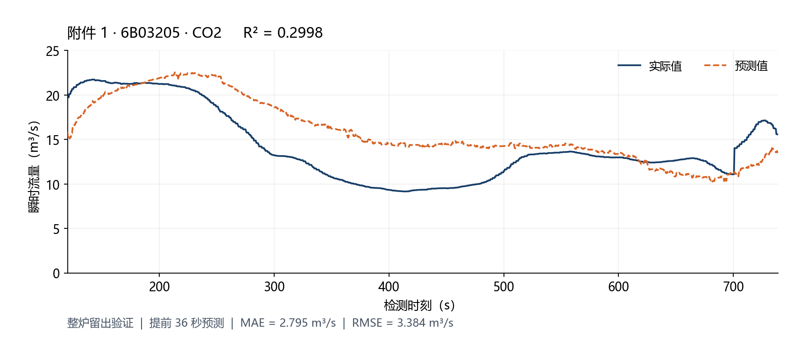

## 附件 1 · 6B03205 · CO

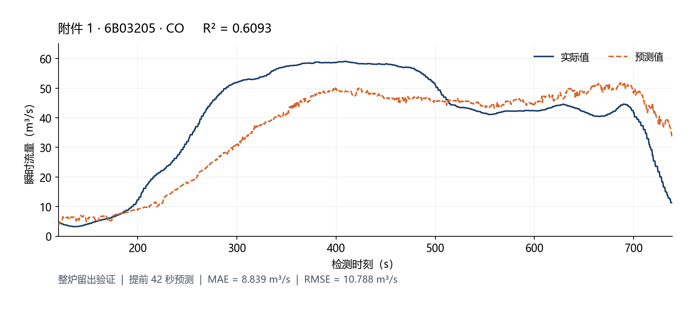

## 附件 2 · 6B03206 · CO2

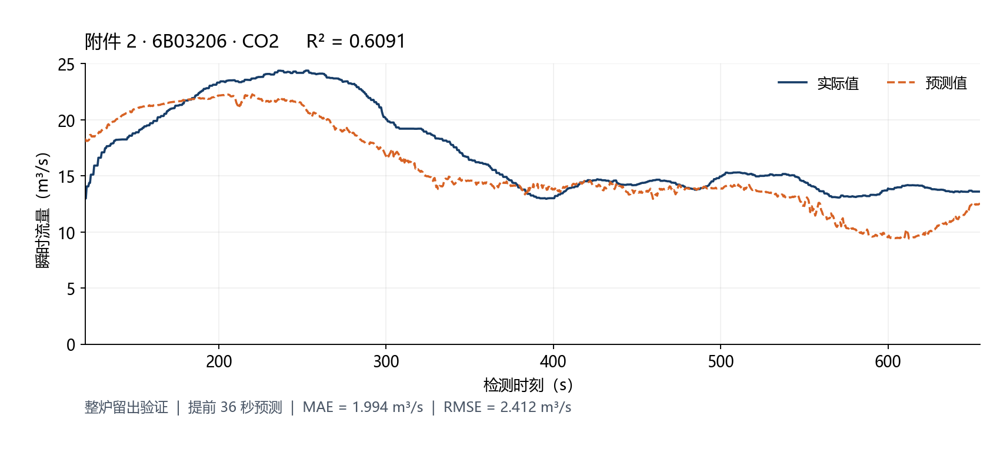

## 附件 2 · 6B03206 · CO

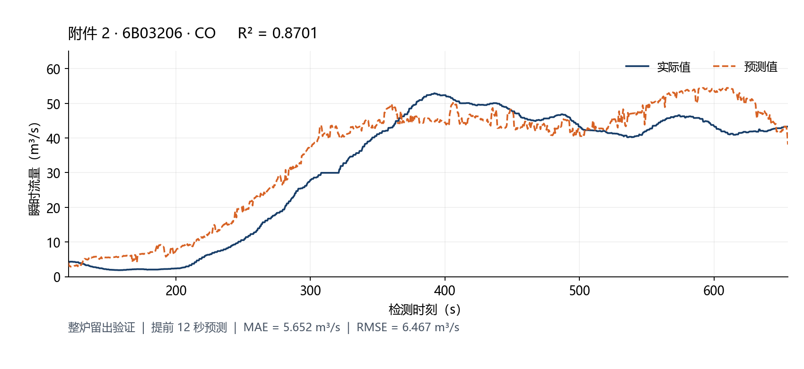

## 附件 3 · 6B03270 · CO2

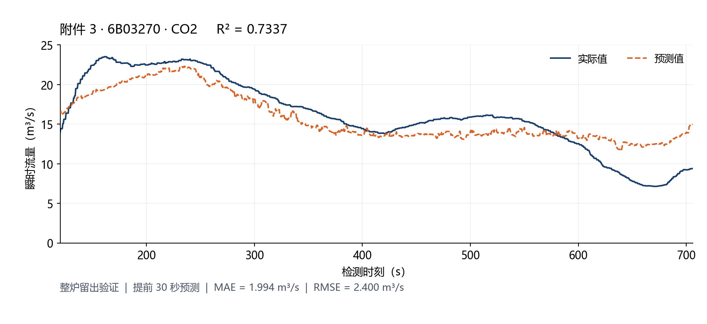

## 附件 3 · 6B03270 · CO

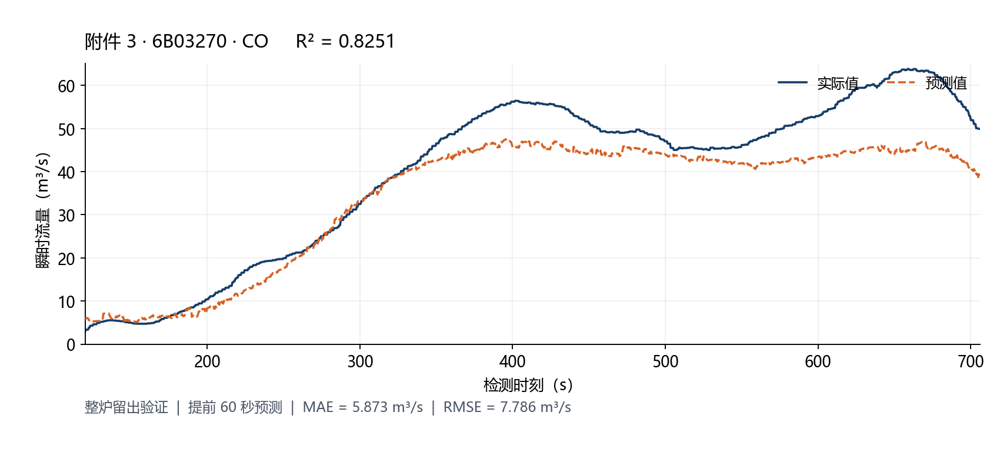

## 附件 4 · 6B03271 · CO2

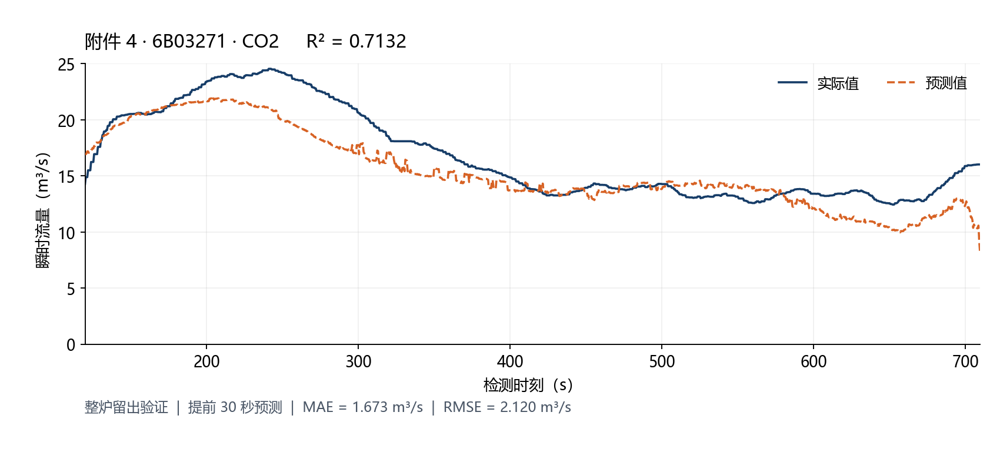

## 附件 4 · 6B03271 · CO

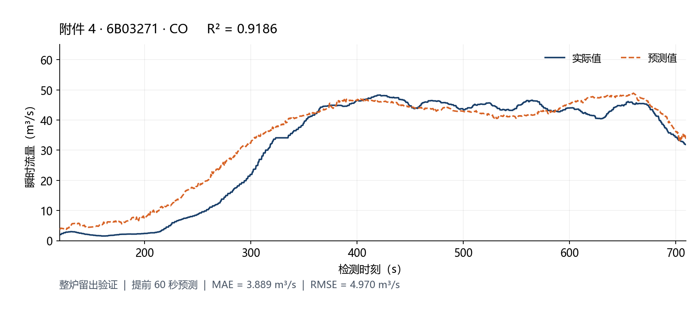

## 附件 5 · 6C02057 · CO2

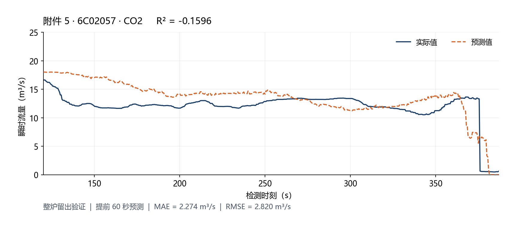

## 附件 5 · 6C02057 · CO

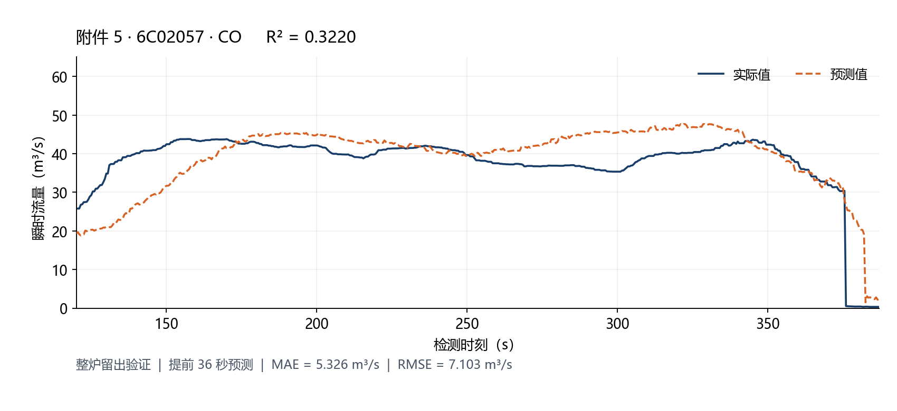

## 附件 6 · 6C02058 · CO2

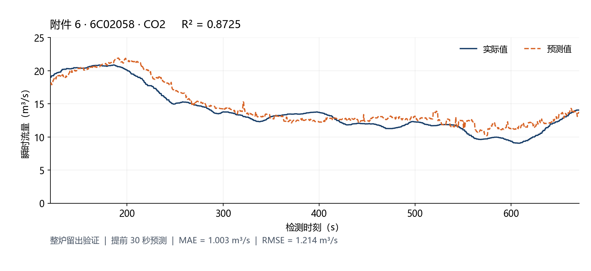

## 附件 6 · 6C02058 · CO

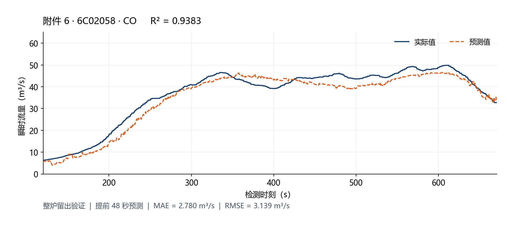

## 附件 7 · 6C02059 · CO2

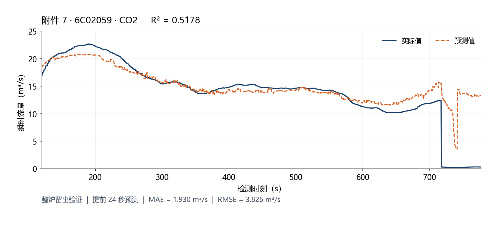

## 附件 7 · 6C02059 · CO

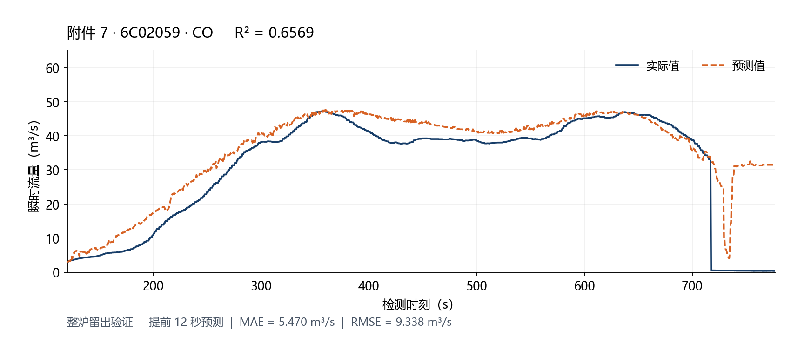

## 附件 8 · 6C02060 · CO2

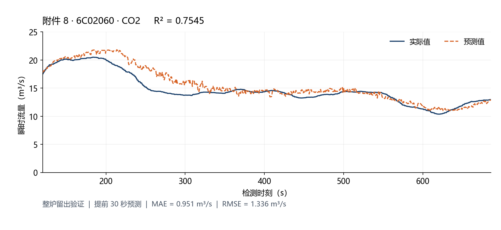

## 附件 8 · 6C02060 · CO

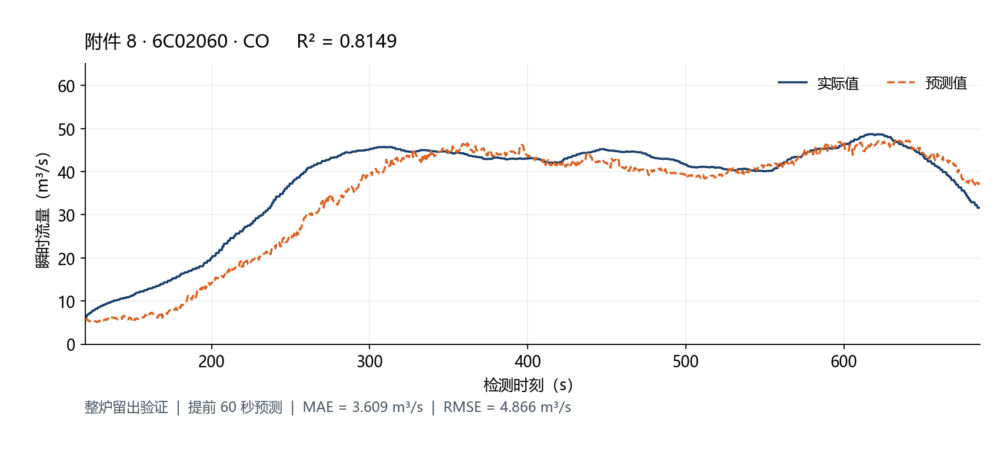

## 附件 9 · 6C02107 · CO2

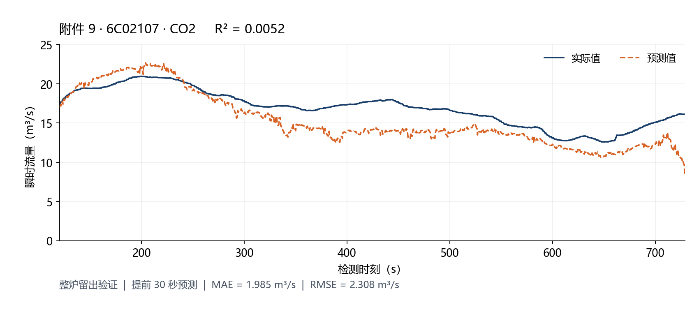

## 附件 9 · 6C02107 · CO

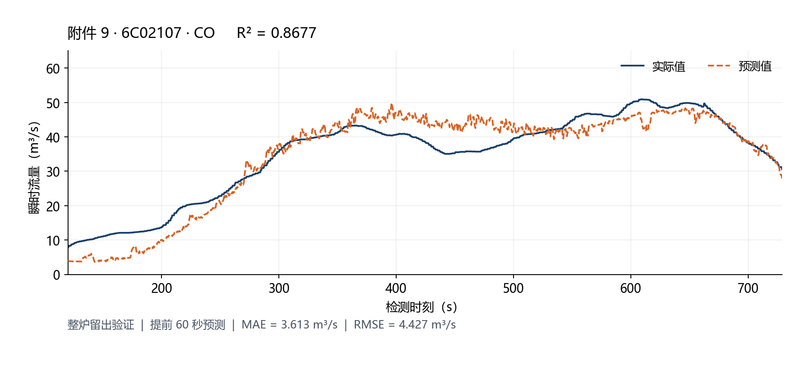

## 附件 10 · 6C02108 · CO2

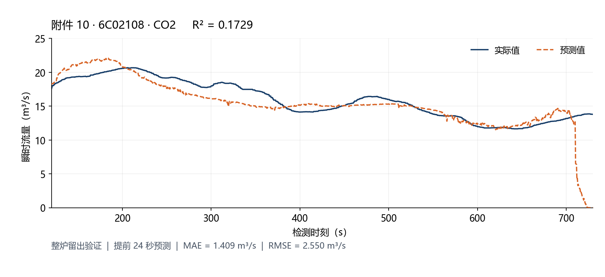

## 附件 10 · 6C02108 · CO

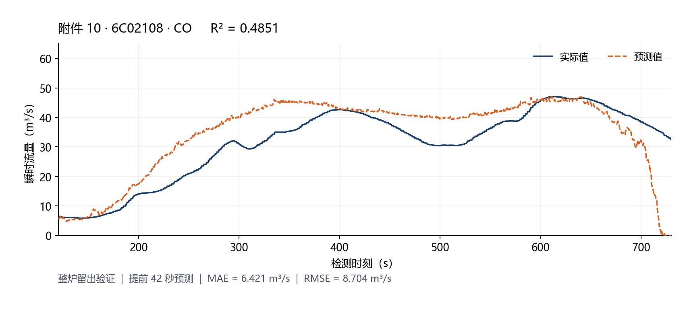
